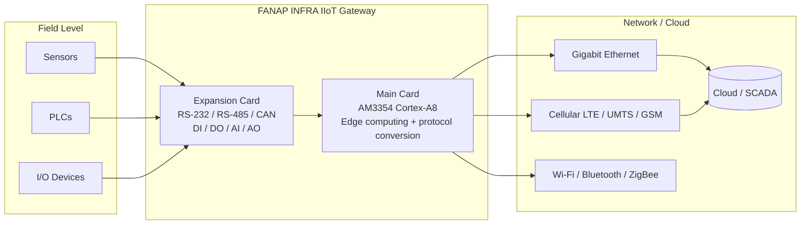

# FANAP INFRA IIoT Edge Gateway

**A modular industrial IoT edge gateway: ARM Cortex-A8 (TI AM3354), multi-protocol conversion, rich industrial I/O, and cellular / Wi-Fi / ZigBee / GPS connectivity.**

-blue)


<p align="center">
  
</p>

---

## Table of Contents

- [Overview](#overview)
- [Key Features](#key-features)
- [System Architecture](#system-architecture)
- [Hardware Interfaces](#hardware-interfaces)
  - [Main Card](#main-card)
  - [Expansion Card](#expansion-card)
- [Technical Specifications](#technical-specifications)
- [Typical Applications](#typical-applications)
- [Repository Contents](#repository-contents)
- [About This Project](#about-this-project)
- [Disclaimer](#disclaimer)
- [Author](#author)

---

## Overview

The **FANAP INFRA Industrial IoT Edge Gateway** acts as a bridge between sensors, I/O devices, PLCs, and the Internet. It collects, processes, and standardizes data from industrial devices before forwarding it to the cloud.

It is a highly configurable and manageable gateway that converts between multiple protocols, such as **MQTT, Modbus, S7, ZigBee, CoAP**, and others. This enables real-time control, production and productivity monitoring, and analysis of individual machines and entire plants.

The device uses a **two-card plug-in design**:

| Card | Role |
|------|------|
| **Main Card** | Compute platform: SoC, memory, storage, networking, wireless, cellular, GPS, power input |
| **Expansion Card** | Industrial field interfaces: serial buses, CAN, digital I/O, analog I/O |

---

## Key Features

- High performance and high reliability
- Flexible interfaces supporting numerous industrial applications
- Multi-protocol support (MQTT, Modbus, S7, ...) with seamless protocol conversion for machine-to-machine and machine-to-cloud communication
- Edge computing and real-time performance
- Energy management
- Flexible input power (9–48 V DC)
- Wide operating temperature range (-20 °C to 70 °C)
- Flexible and cost-effective design, with quick customization for rapid time to market
- Security features: TPM v1.2, Secure Boot, secure firmware update, I/O port disablement, designed around IEC 62443

---

## System Architecture



---

## Hardware Interfaces

<p align="center">
  
</p>

### Main Card

| Interface | Quantity | Notes |
|-----------|:--------:|-------|
| GPS antenna | 1 | SMA female, active and passive antennas supported |
| ZigBee / Wi-Fi antenna | 1 | SMA female (Wi-Fi shares the antenna with Bluetooth) |
| Cellular antenna | 1 | SMA female (optional cellular module) |
| Cellular LED indicators | 3 | Modem status |
| Micro SIM slots | 2 | Dual Micro SIM connector |
| Gigabit Ethernet (RJ-45) | 2 | ETH1, ETH2; ETH1 provides PoE++ PSE |
| USB 2.0 host | 1 | High speed |
| HDMI | 1 | HDMI 1.4A |
| Power input | 1 | 9–48 V DC; 5.08 mm terminal block and 2.5 mm power jack |
| Power button | 1 | |
| Reset button | 1 | |
| Status / Power LEDs | 1 + 1 | |

### Expansion Card

| Interface | Quantity | Notes |
|-----------|:--------:|-------|
| RS-232 | 1 | DB9 (COM) |
| RS-485 | 1 | Terminal block (L / H) |
| CAN | 1 | Terminal block (L / H); Classic CAN 2.0 (CAN FD optional) |
| Digital Input | 8 | 24 V input voltage |
| Digital Output | 4 | 24 V @ 300 mA |
| Analog Output | 1 | Current or voltage output (see specs) |
| Analog Input | 4 | Differential, channel-independent programmable ranges |
| Status LED | 1 | |

---

## Technical Specifications

### Core System

| Parameter | Value |
|-----------|-------|
| Processor | TI AM3354, ARM Cortex-A8, up to 1 GHz |
| Operating system | Linux Kernel 4.14, Android Marshmallow |
| Memory | 512 MB DDR3L (supports up to 1 GB) |
| Storage | 4 GB eMMC onboard (alternatively 8/16/32/64 GB onboard flash) |
| Display | HDMI 1.4A |
| USB | USB host 2.0 high speed |
| Serial ports | 2 × RS-485/422, 1 × RS-232 |
| CAN | 1 × Classic CAN 2.0, 1 × CAN FD (optional) |
| RTC / sensors | Onboard RTC, onboard temperature sensor |

### Connectivity

<details open>
<summary><b>Ethernet &amp; PoE</b></summary>

| Parameter | Value |
|-----------|-------|
| Ports | 2 × RJ-45 (Eth1, Eth2) |
| Speed | 2 × 10/100/1000 Mbps |
| Magnetic isolation | 5 kV |
| PoE | 1 port (Eth1), IEEE 802.3bt PoE++ PSE, up to 90 W, with Automatic Maintain Power Signature (MPS) |

</details>

<details>
<summary><b>Cellular (optional)</b></summary>

| Parameter | Value |
|-----------|-------|
| GSM | 850 / 900 / 1800 / 1900 MHz |
| UMTS | B1 / B5 / B8 |
| LTE FDD | B1 / B3 / B5 / B7 / B8 / B20 |
| Diversity | LTE/UMTS receive diversity |
| Antenna connector | SMA, female |
| SIM | Dual Micro SIM |

</details>

<details>
<summary><b>Wi-Fi</b></summary>

| Parameter | Value |
|-----------|-------|
| Standard | 802.11 a/b/g/n |
| Frequency band | 2.4 GHz |
| Security | WEP, WPA, WPA2, WMM, WMM-PS (U-APSD), WMM-SA |
| Sensitivity | -90 dBm |
| Data rate | Up to 72.2 Mbps |
| Antenna connector | SMA, female (combined with Bluetooth antenna) |

</details>

<details>
<summary><b>Bluetooth</b></summary>

| Parameter | Value |
|-----------|-------|
| Standard | Bluetooth V4.0 |
| Frequency band | 2.4 GHz |
| Sensitivity | -86 dBm |
| Data rate | Up to 3 Mbps |
| Antenna connector | SMA, female (combined with Wi-Fi antenna) |

</details>

<details>
<summary><b>ZigBee</b></summary>

| Parameter | Value |
|-----------|-------|
| Standard | IEEE 802.15.4 |
| Frequency band | 2.4 GHz |
| Tx output power | +4.5 dBm (normal power) or +22 dBm (high power) |
| Rx sensitivity | -98 dBm |
| Antenna connector | SMA, female |

</details>

<details>
<summary><b>GPS</b></summary>

| Parameter | Value |
|-----------|-------|
| Protocols | NMEA, UBX binary, RTCM |
| Accuracy | 2.5 m |
| Update rate | 5 Hz |
| Acquisition | Cold start 27 s, aided start < 3 s, hot start 1 s |
| Sensitivity | Tracking -161 dBm, cold start -147 dBm, hot start -156 dBm |
| Antennas | Active and passive, SMA female |

</details>

### Industrial I/O

| Parameter | Value |
|-----------|-------|
| **Analog Input** (4 ch) | Channel-independent programmable ranges. Bipolar: ±10.24 V, ±5.12 V, ±2.56 V. Unipolar: 10.24 V, 5.12 V |
| **Analog Output** (1 ch), current | 4–20 mA, 0–20 mA, 0–24 mA |
| **Analog Output** (1 ch), voltage | 0–5 V, 0–10 V, ±5 V, ±10 V; 0–5.5 V, 0–11 V, ±5.5 V, ±11 V (10 % over range) |
| **Digital Input** (8 ch) | 24 V input voltage |
| **Digital Output** (4 ch) | 24 V @ 300 mA |

### Power

| Parameter | Value |
|-----------|-------|
| Input voltage | 9 to 48 V DC |
| Input current | 3 A @ 12 V, 1.5 A @ 24 V |
| Connectors | 5.08 mm terminal block, 2.5 mm power jack |

### Software & Security

| Parameter | Value |
|-----------|-------|
| Network protocols | TCP, UDP, DHCP, NAT, HTTP, HTTPS, DNS, RIP, OSPF, NTP, SMTP, Telnet, etc. |
| Serial services | TCP client/server, UDP, Modbus RTU gateway |
| Industrial protocols | MQTT, Modbus, S7, ZigBee, CoAP, and more |
| Programming languages | C, C++, Perl, Java |
| Security | TPM v1.2 (Linux OS), Secure Boot, secure firmware update, I/O port disablement, security based on IEC 62443 |

### Mechanical & Environment

| Parameter | Value |
|-----------|-------|
| Operating temperature | -20 °C to 70 °C |
| Storage temperature | -40 °C to 85 °C |
| Dimensions (W × D × H) | 115 × 77 × 22 mm |
| Housing / weight | Metal, 1.6 kg |
| Mounting | Desktop, VESA, DIN-rail, wall mount |

### Indicators & Controls

- 1 × Status LED (Main Card)
- 1 × Status LED (Expansion Card)
- 3 × Modem status LEDs
- 1 × Link LED and 1 × Speed LED per Ethernet port
- 1 × Reset button, 1 × Power button

---

## Typical Applications

- Protocol conversion between field devices and cloud platforms (e.g. Modbus / S7 to MQTT)
- Real-time machine control and monitoring
- Production and productivity analysis for individual machines or entire plants
- Edge data pre-processing before cloud upload
- Remote sites with cellular backhaul and GPS positioning
- Energy monitoring and management

---

## Repository Contents

```text
.
├── README.md
├── datasheet.pdf               # Full product datasheet
└── docs/
    └── images/
        ├── gateway-overview.png   # Product overview
        └── front-panel.png        # Main / Expansion card interfaces
```

---

## About This Project

This repository presents the **FANAP INFRA IIoT Edge Gateway** and its technical documentation. I prepared the product datasheet while working at **FANAP**.

<!-- Optionally describe your exact contribution here, e.g. hardware bring-up, firmware, protocol stack, documentation. -->

---

## Disclaimer

This is a documentation-only repository. FANAP INFRA and its logo are the property of their respective owner. Specifications are taken from the product datasheet and may change without notice. Refer to the official website, <https://fanap-infra.com>, for current information.

---

## Author

**Pourya**: Embedded Systems Engineer (IoT, industrial, medical, oil & gas)
Embedded C/C++/Python · RTOS & bare-metal (ARM Cortex-M) · Embedded Linux (Cortex-A) · FPGA (VHDL) · Edge AI / TinyML

- GitHub: [your-username](https://github.com/your-username)
- LinkedIn: [your-profile](https://www.linkedin.com/in/your-profile)
- Email: your.email@example.com
