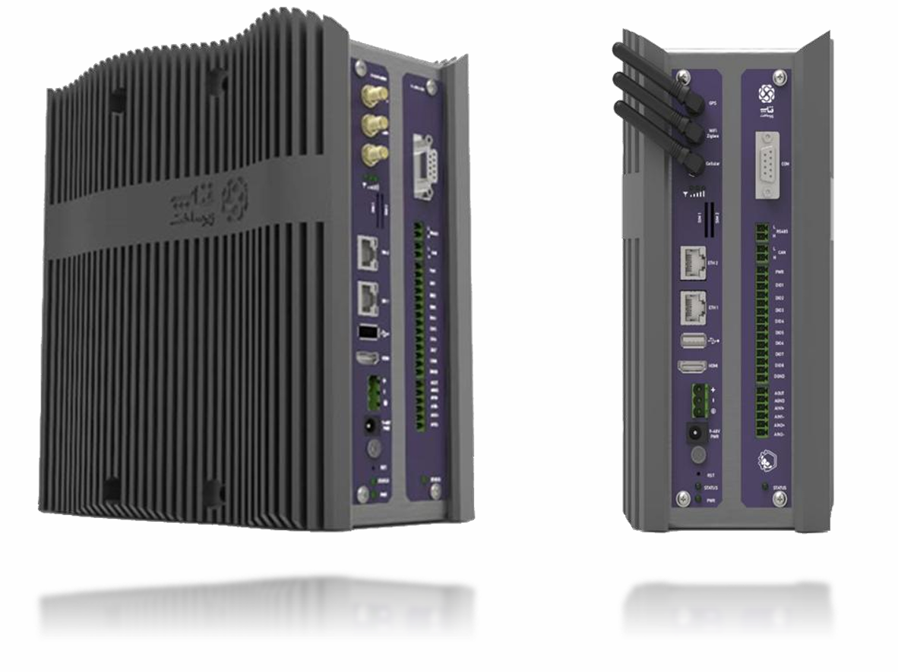
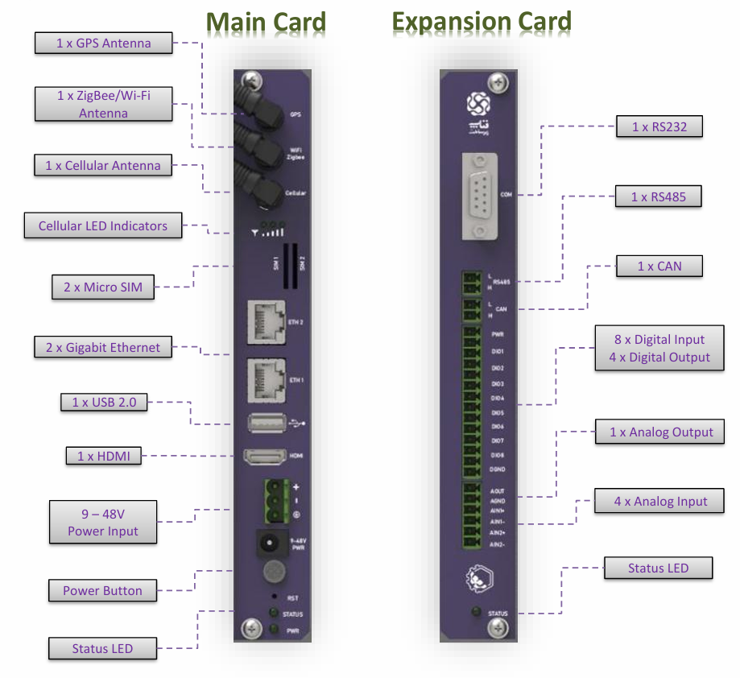
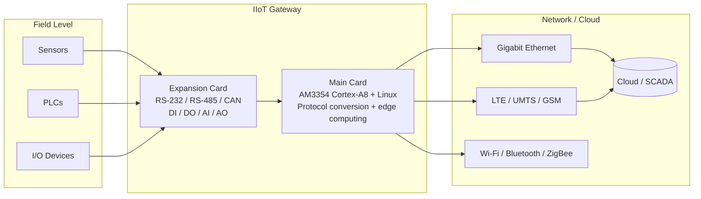

<h1 align="center">Industrial IoT Edge Gateway</h1>
<h3 align="center">End-to-end hardware & firmware design: 8-layer PCB, STM32H7 + FreeRTOS, AM335x embedded Linux</h3>

<p align="center">
  
  
  
  
  
</p>

<p align="center">
  
</p>

> I designed this industrial IoT edge gateway end to end, from schematic and 8-layer PCB layout through MCU firmware, embedded Linux optimization, and a bring-up and validation framework for 10+ interfaces.
> The hardware was designed following **IEC 61000** (EMC), **IEC 60068** (environmental), **IEC 62443** (cybersecurity) and **ATEX** (IEC 60079) guidelines; see [Design standards](#hardware-design).
> It was developed at FANAP Co. (09/2020 – 11/2021) and reached the field as a product.

---

## Table of Contents

- [My Role](#my-role)
- [Project at a Glance](#project-at-a-glance)
- [Hardware Design](#hardware-design)
- [Firmware & Software](#firmware--software)
- [Test & Validation Framework](#test--validation-framework)
- [System Architecture](#system-architecture)
- [Interfaces](#interfaces)
- [Technical Specifications](#technical-specifications)
- [Skills Demonstrated](#skills-demonstrated)
- [Repository Contents](#repository-contents)
- [Note on Confidentiality](#note-on-confidentiality)
- [Contact](#contact)

---

## My Role

**Senior Firmware and Hardware Engineer** and **hardware team lead**, responsible for the gateway across the full stack:

| Area | What I did |
|------|------------|
| **Hardware** | Led the hardware team and designed the gateway's electronics end to end, including an **8-layer PCB** with **isolated Gigabit Ethernet**, **CAN**, **USB**, and **HDMI**, following **IEC 61000 / IEC 60068 / IEC 62443 / ATEX** guidelines |
| **MCU firmware** | Developed **STM32H7** firmware on **FreeRTOS** |
| **Embedded Linux** | Optimized code on the **TI AM335x** (Cortex-A8) Linux platform |
| **Protocols** | Implemented multi-protocol firmware for industrial and IoT communication |
| **Validation** | Built a **bring-up, test and debug framework** for 10+ interfaces, including HDMI, Ethernet, CAN, RS-485, and USB, that validates hardware, boot processes, and peripherals |

<!-- TODO: add a measurable result here, e.g. "Delivered N units to production" / "boot time reduced from X s to Y s" / "passed EMC / isolation tests". Recruiters look for this line. -->

---

## Project at a Glance

The gateway sits between the plant floor and the cloud. It collects data from sensors, I/O devices, and PLCs, standardizes it, and forwards it upstream. It converts between protocols such as **MQTT, Modbus, S7, ZigBee, and CoAP**.

| | |
|---|---|
| **Architecture** | Two plug-in cards: **Main Card** (compute + connectivity) and **Expansion Card** (industrial field I/O) |
| **Application SoC** | TI AM3354, ARM Cortex-A8, up to 1 GHz, running Linux 4.14 |
| **Field I/O** | RS-232, RS-485, CAN, 8 DI, 4 DO, 4 AI, 1 AO |
| **Connectivity** | 2 × Gigabit Ethernet, optional LTE/UMTS/GSM, Wi-Fi, Bluetooth, ZigBee, GPS |
| **Power** | 9–48 V DC input |
| **Environment** | -20 °C to 70 °C operating, DIN-rail / wall / VESA / desktop mounting |
| **Security** | Product features (datasheet): TPM v1.2, Secure Boot, secure firmware update. Hardware designed following IEC 62443 guidelines |

---

## Hardware Design

- **8-layer PCB** carrying high-speed and mixed-signal sections on one board
- **Isolated Gigabit Ethernet** (5 kV magnetic isolation per datasheet)
- **CAN, USB 2.0, and HDMI 1.4A** interfaces
- Wide-range **9–48 V DC** power input
- Industrial field interfaces on a separate **Expansion Card**: RS-232/RS-485, CAN, 24 V digital I/O, programmable analog I/O

**Design standards.** The design took these standards into account: **IEC 61000-4** (ESD, EFT, surge, RF immunity, voltage dips), **IEC 61000-6-2/-6-4** and **CISPR 32** (EMC), **IEC 60068-2** (temperature, humidity, vibration, shock), **IEC 60079** (ATEX), **IEC 62368-1** (safety), **IEC 60529** (IP) and **IEC 62443-4-2** (cybersecurity). They served as design guidelines; no formal certification is claimed.

<!-- Optional: add tools (Altium / KiCad / OrCAD), key ICs, and anything about signal integrity, isolation design, EMC, or bring-up here. -->

<p align="center">
  
</p>

---

## Firmware & Software

| Layer | Details |
|-------|---------|
| **MCU firmware** | STM32H7, FreeRTOS |
| **Application processor** | TI AM335x (Cortex-A8), embedded Linux 4.14, optimized code |
| **Protocols** | MQTT, Modbus (including Modbus RTU gateway), Siemens S7, ZigBee, CoAP, TCP/UDP |
| **Languages** | C, C++ (platform also supports Perl and Java) |

---

## Test & Validation Framework

I built a dedicated **bring-up, test and debug framework** to validate the hardware and software together. It covers 10+ interfaces; the main ones are:

| Interface | Purpose |
|-----------|---------|
| HDMI | Display output validation |
| Ethernet | Link and data-path validation |
| CAN | Bus communication validation |
| RS-485 | Serial bus validation |
| USB | Host interface validation |

It validates the **hardware**, the **boot process**, and the **peripherals**, which shortened the path from a freshly assembled board to a verified one.

<!-- Optional: describe how it works (scripts, loopback fixtures, automated pass/fail report) and which language/tools it uses. -->

---

## System Architecture



---

## Interfaces

<details>
<summary><b>Main Card</b></summary>

| Interface | Qty | Notes |
|-----------|:---:|-------|
| GPS antenna | 1 | SMA female, active/passive |
| ZigBee / Wi-Fi antenna | 1 | SMA female (Wi-Fi shared with Bluetooth) |
| Cellular antenna | 1 | SMA female, optional module |
| Micro SIM | 2 | Dual SIM |
| Gigabit Ethernet | 2 | ETH1 provides PoE++ PSE |
| USB 2.0 host | 1 | High speed |
| HDMI | 1 | HDMI 1.4A |
| Power input | 1 | 9–48 V DC, terminal block + power jack |
| Buttons / LEDs | | Power, reset, status, power, 3 × modem status |

</details>

<details>
<summary><b>Expansion Card</b></summary>

| Interface | Qty | Notes |
|-----------|:---:|-------|
| RS-232 | 1 | DB9 |
| RS-485 | 1 | Terminal block |
| CAN | 1 | Classic CAN 2.0 (CAN FD optional) |
| Digital input | 8 | 24 V |
| Digital output | 4 | 24 V @ 300 mA |
| Analog input | 4 | Programmable ranges, ±10.24 V to ±2.56 V and unipolar |
| Analog output | 1 | 4–20 mA / 0–24 mA or up to ±11 V |
| Status LED | 1 | |

</details>

---

## Technical Specifications

<details>
<summary><b>Core system</b></summary>

| Parameter | Value |
|-----------|-------|
| Processor | TI AM3354, ARM Cortex-A8, up to 1 GHz |
| OS | Linux Kernel 4.14, Android Marshmallow |
| Memory | 512 MB DDR3L (up to 1 GB) |
| Storage | 4 GB eMMC (8/16/32/64 GB alternatives) |
| Display / USB | HDMI 1.4A / USB 2.0 host |
| Serial | 2 × RS-485/422, 1 × RS-232 |
| CAN | 1 × Classic CAN 2.0, 1 × CAN FD (optional) |
| Misc | Onboard RTC, onboard temperature sensor |

</details>

<details>
<summary><b>Wireless & positioning</b></summary>

| Block | Key parameters |
|-------|----------------|
| Cellular (optional) | GSM 850/900/1800/1900 MHz; UMTS B1/B5/B8; LTE FDD B1/B3/B5/B7/B8/B20; RX diversity; dual Micro SIM |
| Wi-Fi | 802.11 a/b/g/n, 2.4 GHz, up to 72.2 Mbps, -90 dBm sensitivity |
| Bluetooth | V4.0, 2.4 GHz, up to 3 Mbps, -86 dBm sensitivity |
| ZigBee | IEEE 802.15.4, 2.4 GHz, +4.5 / +22 dBm Tx, -98 dBm Rx |
| GPS | NMEA / UBX / RTCM, 2.5 m accuracy, 5 Hz, cold start 27 s, hot start 1 s |

</details>

<details>
<summary><b>Ethernet, PoE & power</b></summary>

| Parameter | Value |
|-----------|-------|
| Ethernet | 2 × 10/100/1000 Mbps, 5 kV magnetic isolation |
| PoE | Eth1, IEEE 802.3bt PoE++ PSE, MPS |
| Input voltage | 9–48 V DC |
| Input current | 3 A @ 12 V, 1.5 A @ 24 V |

</details>

<details>
<summary><b>Mechanical & environment</b></summary>

| Parameter | Value |
|-----------|-------|
| Operating temperature | -20 °C to 70 °C |
| Storage temperature | -40 °C to 85 °C |
| Housing / weight | Metal, 1.6 kg |
| Mounting | Desktop, VESA, DIN-rail, wall |

</details>

The full datasheet is in [`datasheet.pdf`](datasheet.pdf).

---

## Skills Demonstrated

`Schematic & PCB design (8-layer)` · `EMC & environmental design (IEC 61000, IEC 60068)` · `ATEX-aware design (IEC 60079)` · `Isolated Ethernet / CAN / USB / HDMI` · `STM32H7` · `FreeRTOS` · `Embedded Linux (AM335x)` · `Bare-metal & RTOS C/C++` · `Industrial protocols (Modbus, S7, MQTT, CoAP, ZigBee)` · `Hardware bring-up & validation` · `Test automation / debug tooling` · `IEC 62443-oriented design`

---

## Repository Contents

```text
.
├── README.md
├── datasheet.pdf                  # Product datasheet I prepared
└── docs/
    └── images/
        ├── gateway-overview.png   # Product overview
        └── front-panel.png        # Main / Expansion card interfaces
```

---

## Note on Confidentiality

This repository is a **portfolio description** of my work and contains documentation only. Schematics, layout files, and source code are proprietary to the employer and are **not** included. Product names and logos belong to their respective owners. Product page: <https://fanap-infra.com/en>.

---

## Contact

**Pourya**, Embedded Systems Engineer · Vienna, Austria
Extensive experience building industrial, oil & gas, medical and IoT products

Embedded C/C++/Python · RTOS & bare-metal (ARM Cortex-M) · Embedded Linux (Cortex-A) · FPGA (VHDL) · Edge AI / TinyML

- GitHub: [PATEmbedded](https://github.com/PATEmbedded)
- LinkedIn: [pourya-afshintabar](https://www.linkedin.com/in/pourya-afshintabar/)
- Email: pouryaafshintabar@gmail.com
